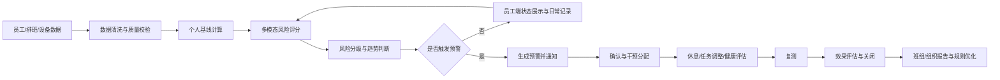
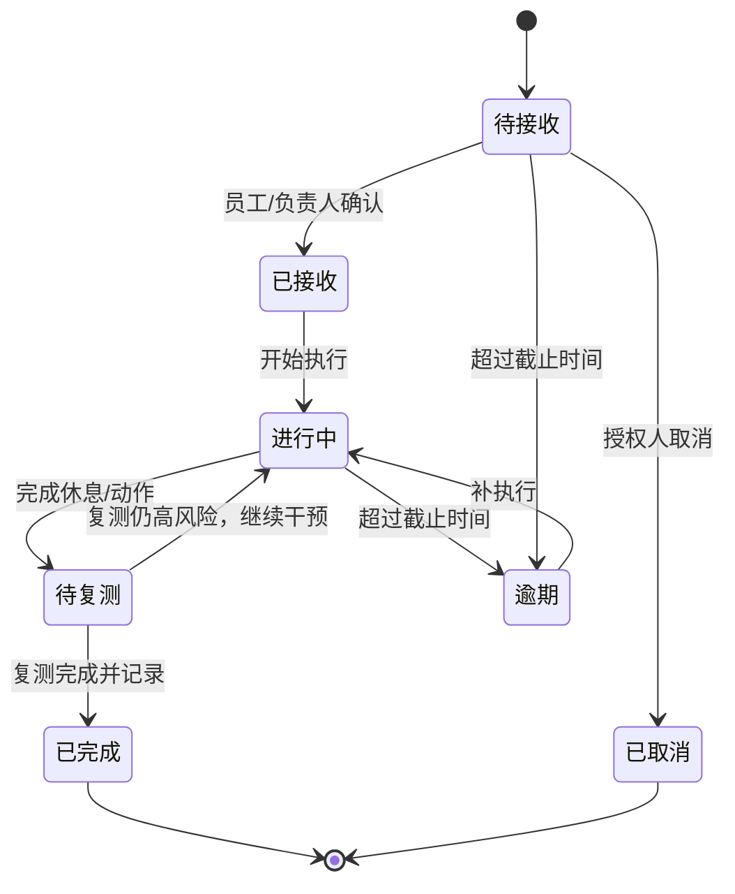
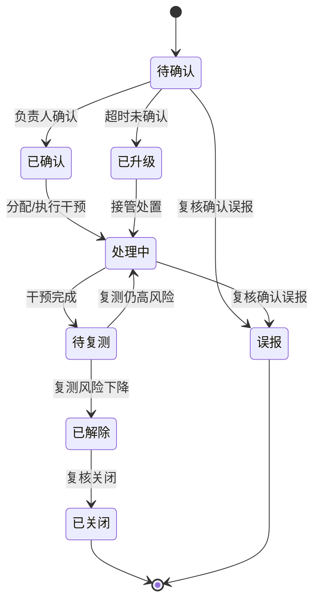
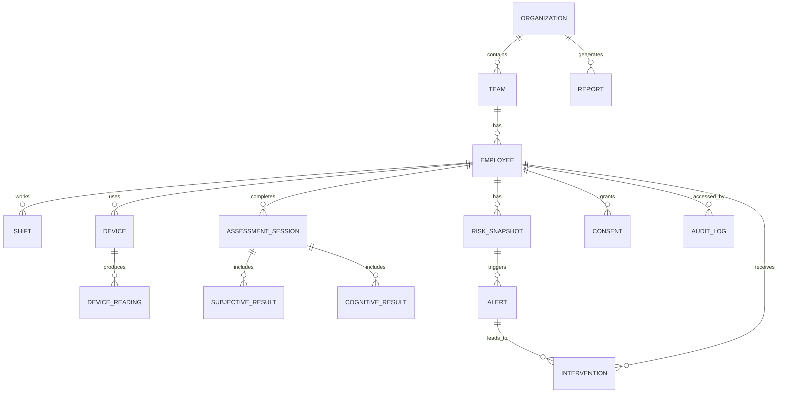

# 职业疲劳智能预警监测系统
## Occupational Fatigue Monitoring Platform

### 产品需求文档（PRD）

| 项目 | 内容 |
|---|---|
| 文档版本 | V1.0 |
| 文档状态 | 评审稿 |
| 更新日期 | 2026-11-09 |
| 产品形态 | Web 网站；管理端桌面优先，员工端移动端优先、响应式适配 |
| 适用阶段 | 原型设计、MVP 研发、试点验证 |
| 目标行业 | 交通运输、制造、能源化工、医疗、矿山等存在夜班或安全敏感岗位的行业 |
| 文档负责人 | 产品组 |

---

## 目录

1. 文档说明
2. 产品概述
3. 用户、角色与权限
4. 核心业务规则：疲劳风险模型与预警
5. 信息架构与页面清单
6. 功能需求
   - 6.1 模块一：员工端（个人主页）
   - 6.2 模块二：多模态疲劳测评
   - 6.3 模块三：疲劳风险预测与分级预警
   - 6.4 模块四：风险干预与恢复管理
   - 6.5 模块五：管理端（安全管理与风险决策）
7. 通用功能与交互要求
8. 数据模型、接口与技术方案
9. 非功能需求
10. 验收标准与测试场景
11. 版本规划与 MVP 范围
12. 风险、合规与待确认事项
13. 附录

---

# 1. 文档说明

## 1.1 文档目的

本文档定义“职业疲劳智能预警监测系统”的产品目标、用户角色、业务流程、功能需求、数据规则、权限边界、非功能要求和验收标准，作为产品设计、UI 设计、前端开发、后端开发、算法设计、测试验收和试点实施的共同依据。

## 1.2 目标读者

- 产品经理、交互设计师、视觉设计师
- 前端、后端、算法、数据工程师
- 测试与实施团队
- 企业安全管理、职业健康管理人员
- 参与试点的班组长与员工代表

## 1.3 需求优先级

| 优先级 | 定义 |
|---|---|
| P0 | MVP 必须交付；缺失时核心业务闭环无法成立 |
| P1 | 首个正式版本应具备；可在 MVP 后一个迭代交付 |
| P2 | 规模化或增强体验需求；不阻塞试点 |

## 1.4 关键术语

| 术语 | 定义 |
|---|---|
| 疲劳风险 | 由生理、主观、认知与工作负荷等多模态数据综合计算出的职业安全风险，不等同于医学诊断 |
| 风险快照 | 系统在某一时刻计算并保存的员工风险结果，包含总分、等级、置信度、各模态分数与主要因素 |
| 个人基线 | 员工在正常状态下连续多日的指标分布，默认使用最近 7 个有效工作日的中位数与稳健离散度 |
| 安全敏感岗位 | 疲劳可能直接导致人身伤害、重大财产损失或公共安全事件的岗位，由企业配置 |
| 班次 | 员工计划或实际执行的工作时段，包括白班、夜班、轮班、加班和休息 |
| 数据完整度 | 当前风险计算所依赖的生理、主观、认知和工作负荷数据的可用程度 |
| 快速测评 | 生理数据 + VAS-F + KSS + PVT 的短流程测评 |
| 完整测评 | 快速测评 + POMS + VST + AX-CPT 的完整多模态测评 |
| 干预 | 为降低疲劳风险而采取的休息、任务调整、复测、转岗或职业健康评估等措施 |
| 预警 | 系统因风险等级、风险变化趋势或数据异常而生成的需要人员关注和处置的事件 |

---

# 2. 产品概述

## 2.1 背景与问题

夜班、长时间连续作业、倒班和不规则休息会显著增加员工疲劳程度，进而降低警觉性、反应速度和执行控制能力，增加操作失误与安全事故风险。传统疲劳管理通常依赖班前口头询问、纸质问卷或事故后的复盘，存在以下问题：

- **碎片化**：生理、主观感受、注意力表现和排班信息彼此割裂。
- **滞后性**：往往在事故或异常发生后才发现问题。
- **不可解释**：只给出“疲劳/不疲劳”的结论，无法说明原因。
- **缺少闭环**：发现风险后没有明确的休息、复测、跟踪和效果评估流程。
- **管理粗放**：管理者难以掌握班组、班次和岗位层面的风险分布。

本产品通过可穿戴设备、标准化量表和注意力任务采集多模态数据，形成“监测—评估—预警—干预—复测—复盘”的闭环，帮助员工及时自我调节，帮助管理者做出更安全、更及时的人员与任务安排。

## 2.2 产品定位

**面向企业的职业疲劳风险识别与干预平台**，不是医疗诊断系统，不替代职业健康医师的专业判断，也不作为员工绩效惩罚工具。

核心价值主张：

1. **更早发现**：在风险升级为事故之前识别疲劳信号。
2. **更准解释**：用可理解的因素说明“为什么当前有风险”。
3. **更快处置**：将预警转化为可执行、可追踪的干预任务。
4. **更稳运营**：为排班、班组管理和职业健康决策提供数据支持。

## 2.3 产品目标

### 业务目标

- 建立企业级员工疲劳风险档案和持续监测能力。
- 将高风险员工的识别和响应时间缩短到分钟级。
- 形成可审计的预警—干预—复测闭环。
- 为安全管理提供班组、班次、岗位维度的决策依据。

### 用户目标

- 员工能在 1 分钟内了解自己当前是否可以安全工作。
- 员工知道下一步应该做什么，并能方便地完成休息和复测。
- 班组长能快速看到本班组需要关注的人，并完成确认和干预。
- 安全管理员能掌握整体风险分布、趋势和处置效果。

### 建议成功指标

| 指标 | 建议目标 | 说明 |
|---|---|---|
| 测评完成率 | ≥ 70% | 应完成测评的班次中实际完成的比例 |
| 高风险预警确认中位时长 | ≤ 5 分钟 | 从预警生成到负责人确认 |
| 严重风险预警确认中位时长 | ≤ 3 分钟 | 严重风险必须更快响应 |
| 干预任务按时完成率 | ≥ 80% | 到期前完成的比例 |
| 预警误报率 | ≤ 15% | 经复核标记为误报的比例 |
| 设备在线率 | ≥ 95% | 应在线设备中正常上报的比例 |
| 员工对建议有用性的评分 | ≥ 4/5 | 干预后的主观反馈 |
| 风险复测改善率 | ≥ 60% | 干预后风险分下降或等级降低的比例 |

## 2.4 产品范围

### 本期范围

- 员工端个人主页、测评中心、风险详情、干预与恢复、个人记录。
- 多模态测评：生理监测接入、VAS-F、KSS、POMS、PVT、VST、AX-CPT。
- 疲劳风险评分、风险分级、趋势分析、风险预测、因素解释。
- 员工端与管理端的预警、干预、复测闭环。
- 管理端驾驶舱、员工管理、风险名单、预警中心、员工详情、班组分析、干预管理、报告中心、系统设置。
- 权限、审计、通知、数据导出、基础合规模块。

### 暂不包含

- 疾病诊断、治疗建议或医疗监护。
- 替代企业急救、职业健康体检或法定职业病鉴定。
- 基于摄像头的面部疲劳识别、隐蔽监控或情绪识别。
- 完整的排班系统、薪酬系统或人事系统。
- 员工绩效评价、纪律处分或自动化的用工决策。
- 自研可穿戴硬件。

## 2.5 前提假设

1. 企业已取得员工对健康相关数据采集和使用的合法授权，并完成告知。
2. 企业能够提供员工、班组、岗位和班次基础数据；首期支持手工导入。
3. 首期可使用模拟设备数据或第三方设备云 API；不依赖浏览器直接连接蓝牙设备。
4. 风险阈值和干预流程需由企业安全管理与职业健康人员共同确认。
5. 员工端以手机浏览器为主，管理端以桌面浏览器为主。
6. 系统默认中文界面、24 小时制、Asia/Shanghai 时区。

---

# 3. 用户、角色与权限

## 3.1 角色定义

| 角色 | 核心诉求 | 主要使用页面 |
|---|---|---|
| 员工 | 了解自身状态、完成测评、按建议休息和复测 | 员工端全部页面 |
| 班组长/直线主管 | 掌握直属团队风险、确认预警、分配干预 | 驾驶舱、风险名单、预警中心、班组分析、干预管理 |
| 安全管理员 | 全组织风险管理、制度配置、报告与复盘 | 管理端全部业务页面 |
| 职业健康专员 | 复核严重风险、查看专业数据、给出健康建议 | 员工详情、预警中心、报告中心 |
| 系统管理员 | 账号、权限、设备、集成和系统配置 | 系统设置、审计日志；默认不可查看员工健康明细 |

## 3.2 权限矩阵

图例：● 完整权限；◐ 受限/按需权限；○ 无权限。

| 权限项 | 员工 | 班组长 | 安全管理员 | 职业健康专员 | 系统管理员 |
|---|---|---|---|---|---|
| 查看本人完整数据 | ● | ○ | ○ | ○ | ○ |
| 查看直属团队聚合数据 | ○ | ● | ● | ◐ | ○ |
| 查看团队个人风险摘要 | ○ | ◐ 仅直属、因工需要 | ● | ● | ○ |
| 查看原始生理/测评数据 | ● 本人 | ○ | ◐ 授权后 | ● | ○ |
| 确认本人预警 | ● | ○ | ○ | ○ | ○ |
| 确认团队预警 | ○ | ● | ● | ◐ | ○ |
| 关闭严重预警 | ○ | ◐ 仅执行处置，不可单独关闭 | ● 需复核 | ● 需复核 | ○ |
| 分配干预任务 | ○ | ● 直属团队 | ● | ● | ○ |
| 导出个人报告 | ● 本人 | ○ | ◐ 授权后 | ● | ○ |
| 导出团队/组织报告 | ○ | ◐ 聚合数据 | ● | ◐ | ○ |
| 配置风险阈值 | ○ | ○ | ◐ 提议，需审批 | ◐ 提议，需审批 | ● 执行 |
| 管理用户与角色 | ○ | ○ | ○ | ○ | ● |
| 查看审计日志 | ○ | ○ | ◐ | ○ | ● |

## 3.3 权限与隐私原则

- **最小必要**：班组长默认只看风险等级、主要因素和处置状态，不展示完整的主观问卷逐题回答和原始生理波形。
- **因工授权**：查看员工明细必须有明确业务目的，系统记录访问日志。
- **严重风险双人复核**：严重风险关闭需安全管理员或职业健康专员复核，班组长不能单独关闭。
- **系统管理员默认脱敏**：系统管理员负责系统运行，不应默认拥有健康数据查看权限。
- **员工知情**：员工可查看自己的数据、风险解释、预警记录和干预记录。
- **禁止惩罚性使用**：未经单独制度安排和员工同意，不得将疲劳数据用于绩效、薪酬或纪律处分。

---

# 4. 核心业务规则：疲劳风险模型与预警

本章规则适用于员工端和管理端所有风险展示，是系统最核心的业务规则。

## 4.1 数据来源与时效

| 数据类别 | 来源 | 关键内容 | 默认有效期 |
|---|---|---|---|
| 生理数据 | 可穿戴设备、设备云 API、CSV 导入、手工录入 | 心率、HRV、呼吸率、皮温、血氧、体动、佩戴状态 | 15 分钟 |
| 主观数据 | 员工填写 | VAS-F、KSS、POMS | 8 小时 |
| 认知数据 | PVT、VST、AX-CPT | 反应时、遗漏、错误、注意力评分 | 24 小时；安全敏感岗位建议 8 小时 |
| 工作负荷 | 排班系统或手工排班 | 班型、开始/结束时间、休息、加班、连续工作天数 | 当前班次实时 |
| 个人基线 | 系统计算 | 最近 7 个有效工作日的中位数与稳健离散度 | 每日更新 |

超过有效期的数据不得作为“当前状态”展示，应标注“数据已过期”，并提示重新采集。

## 4.2 风险总分计算

系统将各模态归一化为 0–100 的风险分，分数越高表示风险越大：

```text
风险总分 R = 0.35 × P + 0.25 × S + 0.25 × C + 0.15 × W + M

P：生理风险分（0–100）
S：主观疲劳分（0–100）
C：认知/注意力风险分（0–100）
W：工作负荷风险分（0–100）
M：情境修正项，范围 0–10
```

### 生理风险分 P

- 以个人基线为参照，计算心率、HRV（优先 RMSSD，辅以 SDNN、pNN50）、呼吸率、皮温等指标的稳健偏差。
- HRV 低于基线、心率高于基线、呼吸率异常升高时，风险分上升。
- 对运动伪影、设备脱落、异常值进行质量过滤，低质量数据不参与计算。
- 冷启动阶段（有效基线不足 3 天）使用岗位/年龄段的群体参考值，并标注“基线建立中”。

### 主观风险分 S

建议默认权重：

```text
S = 0.45 × VAS-F 归一化分 + 0.30 × KSS 归一化分 + 0.25 × POMS-TMD 归一化分
```

某项缺失时，在可用项之间重新归一化，不将缺失项按 0 分处理，同时降低整体置信度。

### 认知风险分 C

由 PVT、VST、AX-CPT 的标准化结果加权得到。首期允许使用其中一项或两项；缺项时重新归一化并降低置信度。具体指标见 6.2。

### 工作负荷风险分 W

| 因素 | 建议分值 | 说明 |
|---|---|---|
| 夜班/跨夜班 | 0–40 | 按班次覆盖的生理夜间时段计算 |
| 加班时长 | 0–25 | 超过标准工时后递增 |
| 连续工作天数 | 0–20 | 连续第 4 天起明显上升 |
| 距上次休息时长 | 0–15 | 连续工作越久分值越高 |

### 情境修正项 M

| 情境 | 建议加分 |
|---|---|
| 当前为夜班 | +5 |
| 安全敏感岗位 | +5 |
| 连续第 3 个及以上夜班 | +5 |
| 近期已发生预警且未完成复测 | +5 |
| 合计上限 | +10 |

所有阈值、权重和修正项必须可配置，不得硬编码在前端。

## 4.3 风险等级

| 等级 | 分数区间 | 颜色语义 | 状态含义 | 建议员工动作 | 管理端动作 | 响应时限 |
|---|---|---|---|---|---|---|
| 低风险 | 0–24.9 | 绿色 | 状态平稳，未见明显疲劳信号 | 保持规律休息，按计划工作 | 常规关注，不生成强制预警 | 无需确认 |
| 关注 | 25–49.9 | 黄色 | 出现轻度疲劳信号，建议主动调节 | 10–15 分钟休息、补水、调整节奏，60 分钟内复测 | 进入风险名单，班组长可见 | 建议 60 分钟内关注 |
| 高风险 | 50–74.9 | 橙色 | 疲劳明显，注意力与生理指标可能已受影响 | 暂停安全敏感作业，休息 20–30 分钟后复测 | 班组长确认并安排干预 | 确认 ≤ 10 分钟 |
| 严重风险 | ≥ 75 或触发严重规则 | 红色 | 不建议继续从事安全敏感作业 | 立即停止安全敏感作业，告知班组长，接受职业健康评估 | 班组长、安全管理员、职业健康专员联动处置 | 确认 ≤ 3 分钟 |

> 严重风险不等于医学急症。如员工出现胸痛、晕厥、意识障碍、明显呼吸困难等情况，应立即启动企业急救流程并就医。

## 4.4 严重风险覆盖规则

满足以下任一条件时，系统可直接标记为“严重风险”，不必等待总分达到 75：

1. 风险总分 ≥ 75。
2. KSS ≥ 8，且员工当前岗位为安全敏感岗位。
3. 3 分钟 PVT 中出现 ≥ 5 次 lapse（反应时 > 500 ms），且主观风险分 S ≥ 60。
4. 生理与认知两个模态的风险分均 ≥ 80。
5. 风险分在 60 分钟内上升 ≥ 20 分，且当前总分 ≥ 65。

覆盖规则触发时：

- 预警立即生成，不等待人工确认。
- 员工端展示不可忽略的红色提示。
- 班组长、安全管理员和职业健康专员按通知矩阵接收。
- 员工需停止安全敏感作业并完成休息/复测；严重预警不能由员工自行关闭。

## 4.5 数据充分性与置信度

| 状态 | 条件 | 展示方式 | 风险计算 |
|---|---|---|---|
| 完整 | 生理、主观、认知三类数据均在有效期内，设备覆盖率 ≥ 80% | 展示“高置信度” | 按完整权重计算 |
| 部分 | 至少两类数据有效，或设备覆盖率 50%–80% | 展示“中/低置信度” | 在可用模态间重新归一化 |
| 不足 | 少于两类数据有效，或设备覆盖率 < 50% | 展示“待评估”，不显示低风险结论 | 不生成常规风险等级；可生成数据质量提醒 |

例外：安全敏感岗位触发 4.4 的第 2 或第 3 条时，即使其他模态缺失，也生成“初步严重预警”，标注“待复核”，并按严重风险通知。

## 4.6 趋势判断

系统至少保存每次风险计算的结果，形成风险快照序列。

| 趋势 | 规则 |
|---|---|
| 快速上升 | 60 分钟内上升 ≥ 15 分 |
| 上升 | 24 小时内上升 ≥ 10 分，且未达到快速上升 |
| 稳定 | 24 小时内变化在 ±10 分以内 |
| 下降 | 24 小时内下降 ≥ 10 分 |

展示时需同时给出：

- 当前分数与等级
- 与上次快照的变化值
- 与个人 7 日基线的比较
- 变化的主要驱动因素
- 数据新鲜度与置信度

## 4.7 风险预测

首期采用“规则 + 趋势外推”的可解释预测，不使用黑盒模型作为唯一依据。

- 预测时间窗：未来 2 小时、未来 4 小时、本班次结束前。
- 输出：风险等级概率、可能达到的分数区间、置信度。
- 输入：当前风险分、近 4 小时趋势、班次剩余时长、已安排休息、历史同班次模式。
- 数据不足 2 个有效快照或完整度 < 60% 时，不展示数值预测，只展示“数据不足，建议完成测评”。
- 预测结果必须标注“预测，不构成确定结论”，并给出主要假设。
- 预测模型上线前需使用历史数据回测；模型版本、训练时间和主要特征需可追溯。

## 4.8 预警规则

### 预警类型

| 类型 | 说明 | 示例 |
|---|---|---|
| 疲劳预警 | 风险等级或趋势达到规则条件 | 高风险、快速上升、持续关注 |
| 数据质量预警 | 设备脱落、信号差、数据中断 | 安全敏感班次中设备离线超过 10 分钟 |
| 依从性提醒 | 未按计划完成测评或复测 | 班前 30 分钟仍未完成测评 |
| 干预任务提醒 | 干预即将到期或已逾期 | 休息任务逾期 30 分钟 |

### 触发规则

| 编号 | 规则 | 级别 | 接收人 |
|---|---|---|---|
| R-01 | 风险分首次跨入高风险或严重风险区间 | 对应等级 | 员工、班组长、安全管理员（严重时） |
| R-02 | 触发 4.4 的严重风险覆盖规则 | 严重 | 员工、班组长、安全管理员、职业健康专员 |
| R-03 | 60 分钟内风险分上升 ≥ 15 分 | 高 | 员工、班组长 |
| R-04 | 连续 3 个快照处于“关注”且持续 ≥ 2 小时 | 关注 | 员工、班组长摘要 |
| R-05 | 安全敏感岗位班前 30 分钟未完成测评 | 依从性提醒 | 员工、班组长 |
| R-06 | 安全敏感班次中设备离线/脱落 ≥ 10 分钟 | 数据质量 | 员工、班组长 |
| R-07 | 干预任务逾期 ≥ 30 分钟 | 任务提醒 | 员工、班组长；60 分钟后升级安全管理员 |

### 去重、冷却与升级

- 同一员工、同一类型、同一级别的预警在 30 分钟内合并，记录触发次数。
- 同级别预警冷却期为 2 小时；等级升级时立即重新通知，不受冷却期限制。
- 严重风险预警不设冷却期。
- 高风险预警 15 分钟未确认，升级至安全管理员；严重风险预警 10 分钟未确认，升级至现场值班负责人/职业健康专员（可按企业配置）。
- 关注级预警可由后续低风险快照自动解除；高风险和严重风险必须由授权人员确认并关闭。
- 标记“误报”必须选择原因并填写说明，保留审计记录，不得由员工单方面标记。

## 4.9 可解释性要求

每一条风险结果和预警必须回答“为什么”：

- 展示贡献最大的 3 个因素及各自贡献分值。
- 使用员工能理解的语言，例如：“HRV 较你的个人基线下降 28%，提示恢复不足。”
- 提供“查看计算依据”展开项，显示指标、基线、当前值、数据时间和质量。
- 说明哪些数据缺失、缺失对置信度的影响。
- 严重风险必须展示触发的是哪条规则，不允许只显示总分。
- 若使用机器学习模型，展示主要特征、模型版本和“预测”标识；不得用模型输出替代人工复核。

## 4.10 阈值治理

- 默认阈值仅作为初始值，必须由企业安全管理与职业健康人员审核。
- 支持按组织、岗位、班组、班型配置不同阈值。
- 修改阈值需经过“提议—审核—发布”流程，并保留版本记录。
- 发布前支持使用历史数据模拟影响，展示预计新增/减少的预警量。
- 每季度或在累计 500 次新测评后复评阈值；监测预警量、误报率和漏报反馈。
- 不得使用性别、年龄等受保护属性直接决定风险等级；如用于基线参考，需经过合规评估和公平性验证。

---

# 5. 信息架构与页面清单

## 5.1 员工端导航

| 导航 | 页面 | 说明 |
|---|---|---|
| 今日 | E-01 今日主页 | 当前风险、生理、自评、班次、趋势、预警 |
| 测评 | E-02 测评中心 | 生理、主观、注意力测评入口 |
| 风险 | E-05 风险详情 | 风险解释、趋势、预测、建议 |
| 干预 | E-06 干预与恢复 | 预警原因、干预建议、休息计时、复测 |
| 我的 | E-07 我的记录 | 历史测评、预警、干预、设备、隐私设置 |

测评执行页 E-03 和测评报告 E-04 从测评中心进入，不单独占用主导航。

## 5.2 管理端导航

| 导航 | 页面 | 说明 |
|---|---|---|
| 驾驶舱 | A-01 风险管理驾驶舱 | 组织级风险总览 |
| 员工管理 | A-02 员工管理 | 档案、岗位、班组、班型、设备 |
| 风险名单 | A-04 风险名单 | 按等级筛选员工 |
| 预警中心 | A-05 预警中心 | 预警详情、处置、状态 |
| 班组分析 | A-06 班组分析 | 班组风险对比与趋势 |
| 干预管理 | A-07 干预管理 | 任务分配、处理、复测 |
| 报告中心 | A-08 报告中心 | 周报、月报、风险统计 |
| 系统设置 | A-09 系统设置 | 阈值、角色、通知、集成、审计 |

员工详情 A-03 为各页面下钻页面。

## 5.3 页面清单

| 页面 ID | 页面名称 | 所属模块 | 优先级 |
|---|---|---|---|
| E-01 | 今日主页 | 模块一 | P0 |
| E-02 | 测评中心 | 模块二 | P0 |
| E-03 | 测评执行页 | 模块二 | P0 |
| E-04 | 测评报告 | 模块二 | P0 |
| E-05 | 风险详情 | 模块三 | P0 |
| E-06 | 干预与恢复 | 模块四 | P0 |
| E-07 | 我的记录 | 模块四/个人中心 | P1 |
| A-01 | 风险管理驾驶舱 | 模块五 | P0 |
| A-02 | 员工管理 | 模块五 | P0 |
| A-03 | 员工详情 | 模块五 | P0 |
| A-04 | 风险名单 | 模块五 | P0 |
| A-05 | 预警中心 | 模块五 | P0 |
| A-06 | 班组分析 | 模块五 | P1 |
| A-07 | 干预管理 | 模块五 | P0 |
| A-08 | 报告中心 | 模块五 | P1 |
| A-09 | 系统设置 | 模块五 | P1 |

## 5.4 核心业务闭环



---

# 6. 功能需求

## 6.1 模块一：员工端（个人主页）

### 6.1.1 页面目标

员工在 1 分钟内回答三个问题：

1. 我现在能不能安全工作？
2. 为什么？
3. 我应该做什么？

### 6.1.2 页面结构 E-01

页面从上到下依次为：

1. 顶部问候区
2. 今日疲劳状态主卡
3. 生理状态卡、疲劳自评卡、今日班次卡
4. 个人趋势卡
5. 风险预警与建议卡
6. 快捷操作

#### A. 顶部问候区

| 元素 | 内容 | 规则 |
|---|---|---|
| 问候语 | “早上好，张师傅” | 按当地时间变化 |
| 日期时间 | 2026-11-09 星期日 14:30 | 实时更新 |
| 班次徽标 | 白班 / 夜班 / 休息 | 来自排班 |
| 安全敏感标识 | “安全敏感岗位” | 仅相关岗位显示 |
| 设备状态 | “设备已连接” / “未佩戴” / “同步中” | 点击进入设备页 |
| 通知入口 | 未读数 | 点击进入预警/通知列表 |

#### B. 今日疲劳状态主卡

必须展示：

- 当前风险等级：低风险 / 关注 / 高风险 / 严重风险
- 当前风险分：0–100
- 状态说明：根据等级和主要因素生成的自然语言描述
- 数据更新时间与置信度
- 主要因素：最多 3 个，使用标签形式
- 今日峰值风险：当日最高风险分及发生时间（P1）
- 主操作按钮：根据状态显示“开始测评”“去休息”“立即复测”“查看建议”

状态说明示例：

| 等级 | 文案示例 |
|---|---|
| 低风险 | “当前状态平稳，生理与主观指标未见明显异常。请保持规律休息。” |
| 关注 | “出现轻度疲劳信号，HRV 较个人基线下降 12%。建议在 60 分钟内安排一次 10–15 分钟休息，并完成复测。” |
| 高风险 | “当前疲劳风险较高，注意力测试反应时较基线延长。建议暂停安全敏感作业，休息 20–30 分钟后复测。” |
| 严重风险 | “当前疲劳风险严重，不建议继续从事安全敏感作业。请立即告知班组长，并接受职业健康评估。” |
| 待评估 | “当前数据不足，暂时无法给出风险等级。请完成一次快速测评。” |

交互规则：

- 点击等级或分数进入 E-05 风险详情。
- 高风险和严重风险的提示不可被永久关闭；员工可点击“我已知晓”，但提示仍保留在页面顶部。
- 低风险和关注提示可折叠。
- 数据超过有效期时显示“数据已过期”，不得继续显示为当前状态。

#### C. 生理状态卡

| 字段 | 说明 |
|---|---|
| 心率 | 当前值，bpm，显示与个人基线的偏差 |
| HRV | 优先 RMSSD，ms；可展开查看 SDNN、pNN50 |
| 呼吸率 | 次/分钟，P1 |
| 血氧 | %，设备支持时展示，P1 |
| 基线对比 | “较基线 -18%”或“处于个人正常范围” |
| 24 小时迷你趋势 | 心率/HRV 折线，标出班次区间 |
| 设备状态 | 已连接 / 未佩戴 / 电量低 / 同步中 / 离线 |
| 数据质量 | 高 / 中 / 低，附最后同步时间 |
| 操作 | “查看趋势”“检查设备”“重新测量” |

规则：

- 不使用“正常/异常”作为医学判断，使用“相对个人基线”的描述。
- 设备脱落或数据质量低时，展示“数据可能不准确”，不得据此得出低风险结论。
- 超过 15 分钟未更新时，状态改为“数据已过期”。

#### D. 疲劳自评卡

| 字段 | 说明 |
|---|---|
| 最新 VAS-F | 0–100，显示疲劳与精力两个维度 |
| 最新 KSS | 1–9，附文字解释 |
| 最新 POMS-TMD | 如已完成完整测评则展示 |
| 提交时间 | 最后提交时间 |
| 状态 | 未填写 / 已完成 / 已过期 |
| 操作 | “快速自评”“完整测评” |

规则：

- 快速自评包含 VAS-F 与 KSS；POMS 在完整测评中完成。
- 自评结果默认仅员工本人和授权职业健康人员可见；班组长仅看到风险摘要和是否完成，不看到逐题答案。
- 超过 8 小时未更新时标记“已过期”。

#### E. 今日班次卡

| 字段 | 说明 |
|---|---|
| 班型 | 白班 / 夜班 / 休息 / 待确认 |
| 计划时间 | 开始–结束 |
| 实际打卡 | 开始–结束，P1 |
| 当前状态 | 未开始 / 进行中 / 已结束 |
| 剩余时长 | 本班剩余时间 |
| 休息安排 | 计划休息时段与实际休息 |
| 加班 | 已加班时长 |
| 连续工作天数 | 例：连续第 3 天 |
| 安全敏感标识 | 是 / 否 |

规则：

- 无排班数据时显示“未获取到今日班次”，提供“联系班组长”或“手动登记”入口（P1）。
- 跨夜班需正确归属到班次开始日期，避免日期错乱。
- 班次变更后，风险计算中的工作负荷分需重新计算。

#### F. 个人趋势卡

- 默认展示最近 7 天。
- 主图：疲劳风险分折线，叠加低/关注/高/严重阈值带。
- 副图：HRV 与心率趋势，支持切换。
- 背景：班次区间用浅色块标识，夜班使用不同纹理/标签，不能只靠颜色区分。
- 事件标记：测评、预警、干预、复测。
- 缺失数据：用断点表示，不得用 0 填补。
- 悬浮/点击数据点显示时间、分数、等级、主要因素。
- 支持 7 天、14 天、30 天切换（P1）。
- 空状态：“完成首次测评后，这里会显示你的趋势。”

#### G. 风险预警与建议卡

| 场景 | 展示 | 操作 |
|---|---|---|
| 低风险 | 绿色轻提示，可折叠 | 查看建议 |
| 关注 | 黄色提示，说明原因 | 开始休息、预约复测 |
| 高风险 | 橙色醒目提示，说明原因和时限 | 暂停作业、开始休息、立即复测、联系班组长 |
| 严重风险 | 红色全宽提示，固定置顶 | 停止作业、联系班组长、职业健康评估 |
| 数据不足 | 灰色提示 | 完成测评、检查设备 |

必须回答“是否需要休息”：

- 低风险：“暂不需要额外休息，建议按计划休息。”
- 关注：“建议尽快安排 10–15 分钟休息。”
- 高风险：“建议立即暂停安全敏感作业并休息 20–30 分钟。”
- 严重：“不建议继续工作，需立即处置并接受评估。”

#### H. 快捷操作

- 开始快速测评
- 开始休息计时
- 查看今日建议
- 联系班组长
- 检查设备
- 查看历史记录

### 6.1.3 业务规则

1. 首页数据按“当前班次”优先展示；休息日展示最近一次有效数据并标注日期。
2. 风险等级以最新有效风险快照为准；无有效快照时显示“待评估”。
3. 高风险/严重风险提示在页面加载后必须完整展示，不得默认折叠。
4. 员工点击“我已知晓”只记录阅读，不改变风险状态。
5. 所有时间使用企业时区，跨夜班显示“夜班（11-08 22:00 至 11-09 06:00）”。
6. 员工可在 E-07 中查看数据访问记录（P1）。

### 6.1.4 验收标准

- 有完整数据时，首页在 2 秒内展示风险等级、分数、状态说明和主要因素。
- 无数据时展示“待评估”和明确的测评入口，不错误展示“低风险”。
- 设备离线时展示离线状态和数据过期提示，风险结论不被错误降级。
- 高风险/严重风险提示在刷新、重新登录后仍然存在。
- 7 天趋势图正确显示缺失数据断点、班次区间和事件标记。
- 移动端 375px 宽度下无横向滚动，主要操作可一键触达。

---

## 6.2 模块二：多模态疲劳测评

### 6.2.1 页面与流程

#### E-02 测评中心

页面包含三个测评卡片和测评记录：

| 卡片 | 内容 | 状态 |
|---|---|---|
| 生理监测 | 设备连接、最近同步、数据质量、测量时长 | 未连接/已连接/同步中/数据异常 |
| 主观自评 | VAS-F、KSS、POMS 完成情况 | 未开始/进行中/已完成/已过期 |
| 注意力检测 | PVT、VST、AX-CPT 完成情况 | 未开始/进行中/已完成/无效 |

页面顶部提供：

- “快速测评（约 5–8 分钟）”：生理数据 + VAS-F + KSS + PVT。
- “完整测评（约 15–20 分钟）”：全部量表与三项注意力任务。
- 最近一次测评时间、总分、等级、数据完整度。
- 测评建议：安全敏感岗位建议每班次至少一次；其他岗位按企业配置。

#### E-03 测评执行页

统一流程：

1. **准备检查**：确认身份、班次、设备状态；认知任务需检查全屏、键盘/触控、环境安静。
2. **知情提示**：说明测评目的、预计时长、数据用途；首次使用需完成授权。
3. **练习**（认知任务）：提供练习轮次和明确反馈。
4. **正式测评**：显示进度、剩余时间、暂停/退出规则。
5. **质量校验**：检查作答完整性、反应有效性、设备数据质量。
6. **提交**：生成或更新风险快照。
7. **结果**：进入 E-04 测评报告。

规则：

- 测评会话默认 30 分钟内有效；超时未提交则保存草稿并标记“已过期”。
- 认知任务开始后不允许切换页面；切屏次数记录为质量标记。
- 中途退出需二次确认；已完成的题目自动保存。
- 无效测评不计入风险评分，但保留记录并提示重测。
- 同一员工两次完整测评建议间隔 ≥ 30 分钟；安全敏感岗位复测按预警要求执行。

### 6.2.2 生理监测

#### 功能要求

| 编号 | 需求 | 优先级 |
|---|---|---|
| M2-PHY-01 | 支持设备绑定、解绑、状态查看、电量查看 | P0 |
| M2-PHY-02 | 支持第三方设备云 API 或 CSV 导入；首期不依赖浏览器蓝牙 | P0 |
| M2-PHY-03 | 展示心率、HRV（RMSSD/SDNN/pNN50）、呼吸率、皮温、血氧、体动 | P0/P1 |
| M2-PHY-04 | 展示测量时间、所属班次、设备佩戴状态、信号质量 | P0 |
| M2-PHY-05 | 识别设备脱落、数据中断、异常值、重复数据和运动伪影 | P0 |
| M2-PHY-06 | 展示 24 小时/7 天趋势与个人基线带 | P0/P1 |
| M2-PHY-07 | 数据异常时提示检查设备，不直接给出疲劳结论 | P0 |
| M2-PHY-08 | 支持原始数据表查看和导出（授权角色） | P1 |

#### 设备接入方式

| 方式 | 说明 | 适用阶段 |
|---|---|---|
| 设备厂商云 API | 通过 OAuth/API Key 拉取或接收 Webhook | 正式版首选 |
| CSV/Excel 导入 | 批量导入设备数据，适合试点和演示 | MVP |
| 手工录入 | 录入单次心率/HRV 等摘要数据 | MVP 兜底 |
| 伴生 App 蓝牙同步 | 手机 App 连接设备后再同步至平台 | P1 |
| 浏览器 Web Bluetooth | 兼容性有限，不作为主方案 | 不建议 |

#### 生理指标与质量规则

| 指标 | 单位 | 说明 | 数据质量规则 |
|---|---|---|---|
| 心率 | bpm | 当前/均值/最高/最低 | 0 或超出设备量程视为无效 |
| HRV-RMSSD | ms | 短时副交感活动指标 | < 5 ms 或明显异常需复核 |
| HRV-SDNN | ms | 整体心率变异性 | 与 RMSSD 同时异常时提高置信度 |
| pNN50 | % | 相邻 RR 间期差异比例 | 依赖设备支持 |
| 呼吸率 | 次/分 | 设备支持时采集 | 异常高/低值需标记 |
| 皮温 | ℃ | 设备支持时采集 | 剧烈变化需结合环境判断 |
| 血氧 | % | 设备支持时采集 | 不作为单独疲劳判断依据 |
| 体动 | 任意单位 | 判断运动伪影和睡眠/静息状态 | 高体动期间 HRV 降权 |
| 佩戴状态 | 枚举 | 已佩戴/未佩戴/未知 | 未佩戴期间数据不参与评分 |

异常数据处理：

- 单点异常：剔除并记录，不改变整体趋势。
- 连续异常 ≥ 3 个采样点：标记数据段，降低质量分。
- 设备脱落 ≥ 5 分钟：员工端提示重新佩戴。
- 安全敏感班次中设备离线 ≥ 10 分钟：生成数据质量预警。
- 数据质量 < 50%：风险结果标注“低置信度”，不得作为唯一依据。

#### 页面展示

- 当前指标卡：大数字 + 单位 + 基线偏差 + 最后更新时间。
- 趋势图：心率、HRV 双轴或上下双图；班次背景；基线带；异常点标记。
- 设备卡：设备名称、连接状态、电量、佩戴状态、最后同步、信号质量。
- 异常记录表：时间、类型、影响、处理建议。
- 测量记录：开始/结束时间、时长、所属班次、数据完整度。

### 6.2.3 主观自评

#### VAS-F 疲劳视觉模拟量表

| 项目 | 要求 |
|---|---|
| 题目数量 | 18 项，其中疲劳维度 13 项、精力维度 5 项 |
| 评分方式 | 每项 0–100 视觉模拟滑杆 |
| 展示方式 | 分 3 页，每页 6 项，显示进度 |
| 预计时长 | 2–3 分钟 |
| 计分 | 疲劳维度均值与精力维度反向计分后合成 0–100 疲劳分；同时保留两个子维度 |
| 校验 | 所有题目必须作答；滑杆需实际交互，避免默认值造成偏差 |
| 授权 | 使用经确认的中文版本；如涉及授权，需在使用前完成 |

结果解释：

- 0–24：疲劳感较低
- 25–49：轻度疲劳
- 50–74：中度疲劳
- 75–100：高度疲劳

以上区间仅用于产品展示，需结合个人基线和职业健康标准校准。

#### KSS 困倦程度量表

| 项目 | 要求 |
|---|---|
| 题目数量 | 1 项 |
| 评分方式 | 1–9 级单选 |
| 预计时长 | < 30 秒 |
| 锚点 | 1=极度清醒，3=清醒，5=既不清醒也不困倦，7=困倦，9=极度困倦、难以保持清醒 |
| 风险提示 | ≥ 7 提示明显困倦；≥ 8 为严重困倦，安全敏感岗位触发严重规则 |
| 校验 | 必须选择；展示每一级的文字说明 |

#### POMS 情绪状态量表

| 项目 | 要求 |
|---|---|
| 版本 | 优先使用经授权的中文简版 POMS-SF（30 题）；完整版 65 题仅在确认授权和时长可接受时使用 |
| 评分方式 | 0–4 五点计分 |
| 维度 | 紧张-焦虑、抑郁-沮丧、愤怒-敌意、精力-活动、疲劳-惰性、困惑-迷茫 |
| 总分 | TMD = 100 + 负性维度总分 − 精力维度分 |
| 预计时长 | 3–4 分钟 |
| 校验 | 全部作答；过快作答、明显直线作答标记质量风险 |
| 授权 | POMS 为受版权保护工具，上线前必须确认授权；未获授权时不得使用替代名称冒充 |

> VAS-F、KSS、POMS 的结果用于职业疲劳风险管理，不构成心理或医学诊断。POMS 结果涉及情绪信息，应按敏感健康数据管理，仅授权角色可见。

#### 主观测评通用交互

- 顶部说明用途、预计时长、隐私范围。
- 显示进度和“保存并退出”。
- 提交前展示完成度检查。
- 提交后展示分数、等级、简短解释和建议，不展示可能引起误解的“疾病标签”。
- 支持重新测评；保留历史版本，不覆盖旧记录。
- 如员工中途退出，草稿保留 24 小时（P1）。

### 6.2.4 注意力检测

#### 通用要求

- 支持键盘和触控；PVT 建议使用桌面/平板以获得更稳定的反应时，移动端需标记设备类型。
- 正式任务前必须完成练习；练习不计分。
- 任务期间进入全屏，禁止切换页面；记录切屏、失焦、刷新等事件。
- 任务结束后立即给出有效性判断；无效任务需说明原因并允许重测。
- 不在测评过程中使用摄像头、麦克风或人脸分析。
- 所有任务需使用经确认的范式与参数；参数变更需版本化并重新验证。
- 认知测试结果仅作为疲劳/警觉性指标，不作为临床神经心理诊断。

#### PVT 精神运动警觉任务

| 项目 | 要求 |
|---|---|
| 目的 | 测量持续注意力和警觉性，识别反应变慢和注意脱离 |
| 时长 | 默认 3 分钟短版；研究模式可选 10 分钟 |
| 刺激 | 屏幕中央出现视觉计数器或计时器 |
| 反应 | 出现刺激时按空格键/点击按钮 |
| 刺激间隔 | 2–10 秒随机 |
| 关键指标 | 平均反应时、中位反应时、lapse 数（RT > 500 ms）、误按/提前反应、反应时变异性、有效试次 |
| 评分 | 基于反应时、lapse 数和变异性与个人基线/常模比较，输出 0–100 风险分 |
| 无效条件 | 有效试次 < 80%、提前反应占比过高、明显未按要求操作、切屏中断 |
| 结果解释 | “反应时较基线延长，出现 4 次注意中断，提示警觉性下降” |

#### VST 视觉搜索任务

| 项目 | 要求 |
|---|---|
| 目的 | 测量视觉搜索效率、持续注意和遗漏/冲动错误 |
| 时长 | 2–3 分钟 |
| 任务 | 在干扰项矩阵中搜索目标字母/图形；目标出现时按指定键，不出现时按另一键 |
| 试次 | 建议 40–60 个试次，目标出现比例约 50% |
| 关键指标 | 正确率、中位反应时、遗漏错误、误报错误、搜索效率分 |
| 评分 | 综合正确率与反应时，输出 0–100 风险分；错误率优先于速度 |
| 无效条件 | 正确率低于阈值、未完成练习、切屏、明显随机作答 |
| 结果解释 | “搜索正确率下降、遗漏增加，提示持续注意下降” |

#### AX-CPT 执行控制任务

| 项目 | 要求 |
|---|---|
| 目的 | 测量工作记忆、情境维持和执行控制 |
| 时长 | 4–5 分钟 |
| 任务 | 先呈现线索字母 A 或 B，再呈现探测字母 X 或 Y；仅在 A 后接 X 时按“目标”键，其余按“非目标”键 |
| 试次 | 建议 80 个试次；AX 70%、AY 10%、BX 10%、BY 10% |
| 关键指标 | 总正确率、d′、AY 错误率、BX 错误率、反应时、主动控制指数 |
| 评分 | 综合正确率、d′ 和错误模式，输出 0–100 风险分 |
| 无效条件 | 正确率接近随机、练习未完成、切屏、任务中断 |
| 结果解释 | “AY 错误增加，提示维持目标规则的能力下降” |

#### 认知测评结果页

展示：

- 任务名称、完成时间、时长、设备类型。
- 有效性：有效/无效及原因。
- 核心指标表：原始值、个人基线、偏差、风险分。
- 一句话解释。
- 与上次结果对比。
- “重新测试”入口。
- 数据质量提示。

### 6.2.5 测评报告 E-04

报告结构：

1. **结论摘要**：当前风险等级、总分、置信度、数据完整度。
2. **多模态得分**：生理、主观、认知三个模块的分数和等级。
3. **主要因素**：最多 5 项，按贡献排序，附证据。
4. **趋势对比**：与上次测评、7 日基线对比。
5. **建议**：休息、复测、任务调整、联系班组长或职业健康评估。
6. **数据质量**：设备覆盖、无效任务、缺失数据。
7. **免责声明**：仅用于职业疲劳风险管理，不构成医疗诊断。

交互：

- 可保存为个人记录。
- 可导出 PDF（P1）。
- 分享给授权人员需明确确认，并记录分享范围和时间。
- 报告生成后若数据更新，旧报告保留版本号。

### 6.2.6 测评验收标准

- 快速测评可在 8 分钟内完成，完整测评可在 20 分钟内完成（正常操作）。
- 任一主观量表缺少必答题时不能提交，并定位到未完成题目。
- PVT 有效试次不足时判定无效，不纳入风险计算，并提示重测。
- 设备脱落时生理数据不参与评分，报告明确标注数据缺口。
- 测评报告中的分数与后台计算一致，保留原始数据和算法版本。
- 移动端可完成 VAS-F、KSS、POMS、VST（触控）；PVT 在移动端需提示设备延迟风险。
- 所有认知任务均提供练习、全屏、防切屏和有效性校验。

---

## 6.3 模块三：疲劳风险预测与分级预警

### 6.3.1 页面 E-05 风险详情

#### 页面目标

让员工和授权管理者理解当前风险、变化趋势、触发原因和下一步动作。

#### 页面结构

1. 风险总览
2. 风险趋势
3. 触发因素
4. 风险预测
5. 干预建议
6. 历史记录
7. 数据质量

#### A. 风险总览

- 当前风险分、等级、颜色、状态说明。
- 与上次快照的变化：`+8 分`、`上升`。
- 数据更新时间、置信度、数据完整度。
- 今日峰值风险与发生时间。
- 当前班次剩余时间。
- 主操作：开始休息、立即复测、查看干预建议。

#### B. 风险趋势

- 时间范围：24 小时、7 天、30 天。
- 折线图叠加风险阈值带。
- 班次背景与夜班标记。
- 事件标记：测评、预警、干预、复测、设备离线。
- 悬浮显示：时间、分数、等级、主要因素、数据质量。
- 缺失数据断点，不使用 0 填补。
- 支持切换显示生理、主观、认知分项趋势。

#### C. 触发因素

按贡献从高到低展示，至少包括：

| 因素 | 示例文案 | 证据 |
|---|---|---|
| HRV 下降 | “HRV 较个人基线下降 28%，提示恢复不足” | 当前值、基线、测量时间 |
| 心率升高 | “静息心率较基线高 12 bpm” | 当前值、基线、活动状态 |
| 主观困倦 | “KSS=7，属于明显困倦” | 提交时间 |
| 注意力下降 | “PVT 出现 4 次注意中断” | 任务时间、有效性 |
| 夜班负荷 | “连续第 3 个夜班” | 排班记录 |
| 长时间未休息 | “距上次休息 5 小时 20 分” | 班次/休息记录 |
| 设备异常 | “设备离线 18 分钟，数据不完整” | 设备日志 |

展示规则：

- 最多突出 3 个主要因素，其余放入“查看全部”。
- 每个因素显示贡献分值和方向（升高/降低风险）。
- 不使用“因为你有病”之类医学判断。
- 员工可见完整因素；班组长默认只可见摘要因素，除非获得授权。

#### D. 风险预测

- 未来 2 小时、4 小时、本班次结束前的风险等级概率。
- 预测分数区间，例如“预计 62–74 分，高风险概率 58%”。
- 置信度：高/中/低。
- 主要假设：如“假设未来 2 小时无额外休息”。
- 建议：提前安排休息、调整任务、增加复测。
- 数据不足时显示“暂无法预测”，并引导完成测评。
- 明确标注“预测结果，不构成确定结论”。

#### E. 干预建议

每条建议包含：

- 建议动作
- 建议原因（对应因素）
- 建议时长/执行时间
- 优先级
- 预期效果
- 操作按钮：开始、稍后提醒、不需要、联系班组长

建议生成规则见 6.4.3。

#### F. 历史记录

表格字段：

- 时间
- 风险分/等级
- 趋势
- 主要因素
- 数据来源
- 关联预警
- 关联干预
- 复测结果

支持按日期、等级、事件类型筛选，支持导出个人报告（P1）。

#### G. 数据质量

- 设备覆盖率
- 生理数据缺失时长
- 主观/认知数据时效
- 无效测评次数
- 当前置信度说明

### 6.3.2 业务规则

1. 风险详情默认显示当前班次；休息日显示最近一次班次。
2. 风险分和等级必须来自同一风险快照，避免前端自行拼接不同时间的数据。
3. 风险变化趋势至少需要两个有效快照；不足时显示“数据积累中”。
4. 预测结果不得覆盖当前风险等级，只能作为辅助信息。
5. 员工可对风险结果反馈“准确/不准确”，反馈进入模型评估队列，不直接改变风险等级。
6. 管理者查看员工风险详情需记录访问日志。

### 6.3.3 验收标准

- 风险总览的分数、等级、因素与后台风险快照一致。
- 趋势图正确显示阈值、班次和缺失数据。
- 严重风险页面明确显示触发规则和处置要求。
- 预测数据不足时不出现误导性数值。
- 员工无法修改风险结果，只能提交反馈或复测。
- 班组长无法查看超出授权范围的员工数据。

---

## 6.4 模块四：风险干预与恢复管理

### 6.4.1 页面 E-06 干预与恢复

#### 页面目标

把“发现风险”转化为“完成动作”，并验证干预是否有效。

#### 页面结构

1. 当前预警与原因
2. 推荐干预
3. 恢复计划与计时
4. 复测
5. 效果反馈
6. 历史干预

#### A. 当前预警与原因

展示当前未关闭的预警：

| 字段 | 说明 |
|---|---|
| 预警等级 | 关注/高/严重 |
| 触发时间 | 精确到分钟 |
| 触发原因 | 主要因素标签 + 自然语言说明 |
| 状态 | 待确认/已确认/进行中/待复测/已解除 |
| 响应时限 | 剩余时间或已逾期 |
| 关联数据 | 风险快照、测评报告 |
| 操作 | 确认、开始休息、联系班组长、申请复核 |

规则：

- 高风险/严重风险预警必须展示处置步骤，不只展示“注意休息”。
- 员工可确认预警，但不能关闭严重预警。
- 预警原因需与风险因素一致，不能使用通用模板替代。

#### B. 推荐干预

干预卡片包含：

- 名称：如“20 分钟恢复性休息”
- 适用原因
- 建议时长
- 执行步骤
- 注意事项
- 预期效果
- 操作：开始、换一个、稍后提醒

常见干预库：

| 干预 | 适用场景 | 建议时长 | 注意事项 |
|---|---|---|---|
| 微休息 | 关注级疲劳、连续作业 | 5–10 分钟 | 离开工位、活动肩颈、远眺 |
| 恢复性休息 | 高风险、HRV 明显下降 | 20–30 分钟 | 安静环境、减少屏幕刺激 |
| 策略性小睡 | 夜班、严重困倦 | 15–20 分钟 | 需在安全场所；避免过长导致睡眠惯性 |
| 任务轮换 | 注意力下降、重复作业 | 按班组安排 | 暂停安全敏感任务，改为低风险任务 |
| 双人复核 | 高风险但暂不能离岗 | 当班期间 | 由同伴复核关键操作 |
| 补水/轻食 | 长时间作业、轻度疲劳 | 5–10 分钟 | 遵循企业职业健康建议 |
| 光照调节 | 夜班困倦 | 当班期间 | 避免影响后续睡眠 |
| 呼吸放松 | 紧张、心率偏高 | 3–5 分钟 | 缓慢呼吸，不替代休息 |
| 班组长关怀确认 | 高风险/严重风险 | 10 分钟内 | 确认员工状态与任务安排 |
| 调整排班/休息日 | 连续多日高风险 | 按制度 | 需班组长/安全管理员审批 |
| 职业健康评估 | 严重风险、反复高风险 | 按流程 | 由职业健康专业人员执行 |
| 设备检查/重新佩戴 | 数据质量预警 | 5 分钟内 | 确认电量、佩戴位置、信号 |

干预建议必须考虑：

- 当前岗位是否安全敏感
- 班次剩余时间
- 是否已接近下班/睡眠时间（咖啡因等建议需谨慎）
- 员工是否有已知健康限制（仅使用授权信息）
- 是否已执行过同类干预及效果

#### C. 恢复计划与计时

- 员工选择干预后，启动计时器。
- 计时器显示剩余时间、结束提醒、暂停/提前结束。
- 休息结束后自动提示复测。
- 支持“我在休息”状态，班组长可见状态但不查看具体位置。
- 休息期间不采集与休息无关的额外数据。
- 计时结束后记录实际休息时长。

#### D. 复测

复测流程：

1. 休息结束后提示“进行复测”。
2. 默认快速复测：生理数据 + KSS + PVT。
3. 展示干预前/后对比：风险分、等级、主要指标。
4. 若风险仍为高/严重，提示继续休息、联系班组长或职业健康评估。
5. 若风险降至关注/低，记录干预有效，进入观察。
6. 复测结果自动关联原预警和干预任务。

复测规则：

- 高风险干预后建议 30 分钟内复测。
- 严重风险需在授权人员确认后复测，不能仅凭一次复测恢复安全敏感作业。
- 复测无效时提示重新测量，不将无效结果作为改善证据。

#### E. 效果反馈

- 员工对干预有用性评分：1–5 分。
- 选择原因：有帮助/没时间/环境不允许/不适合我/其他。
- 可选文字反馈。
- 反馈用于优化建议，不直接改变风险算法。
- 员工可查看自己的干预历史与效果。

#### F. 历史干预

表格字段：时间、干预类型、原因、执行时长、干预前风险、复测风险、效果、状态。

### 6.4.2 干预任务状态机



### 6.4.3 干预建议生成规则

| 主要因素 | 首选干预 | 备选干预 | 升级条件 |
|---|---|---|---|
| HRV 显著低于基线 | 20–30 分钟恢复性休息 | 呼吸放松、任务轮换 | 复测仍高 → 班组长介入 |
| 心率持续偏高 | 休息、补水、离开高温/高噪环境 | 任务轮换 | 伴随不适 → 职业健康评估 |
| KSS ≥ 7 | 休息/策略性小睡 | 光照、任务轮换 | KSS ≥ 8 且安全敏感 → 停止作业 |
| PVT lapse 增多 | 停止安全敏感任务，休息后复测 | 双人复核 | 复测无效或仍严重 → 职业健康评估 |
| VST/AX-CPT 错误增加 | 降低任务复杂度、双人复核 | 休息、复测 | 反复出现 → 调整排班 |
| 连续夜班/加班 | 调整排班、安排休息日 | 班中策略性小睡 | 连续多日高风险 → 安全管理员审批 |
| 设备脱落/离线 | 检查设备、重新佩戴 | 手工测量 | 无法恢复 → 数据质量预警 |
| 主观自评与生理不一致 | 复测、班组长关怀确认 | 职业健康咨询 | 持续不一致 → 人工复核 |

### 6.4.4 干预验收标准

- 高风险预警生成后，员工端 1 分钟内可见处置步骤。
- 休息计时器可正常开始、暂停、结束，并记录实际时长。
- 复测结果与原预警、干预正确关联。
- 严重风险不能由员工自行关闭；必须由授权人员复核。
- 干预效果可在个人历史和管理端任务列表中查看。
- 逾期任务按规则提醒并升级。

---

## 6.5 模块五：管理端（安全管理与风险决策）

### 6.5.1 A-01 风险管理驾驶舱

#### 页面目标

让安全管理员在 30 秒内掌握“多少人、哪些人、什么原因、处理得怎么样”。

#### 筛选栏

- 时间范围：今日/近 7 天/近 30 天/自定义
- 组织/部门
- 班组
- 班型：白班/夜班/全部
- 岗位/安全敏感标识
- 刷新时间与自动刷新开关（默认 60 秒）

#### KPI 卡片

| 指标 | 定义 | 点击行为 |
|---|---|---|
| 员工总数 | 当前组织在职且启用监测的员工数 | 进入员工管理 |
| 当班人数 | 当前时间处于班次内的员工数 | 进入员工管理并筛选当班 |
| 高风险 + 严重风险人数 | 当前最新快照为高/严重的去重员工数 | 进入风险名单 |
| 待处理预警 | 状态为待确认/处理中的预警数 | 进入预警中心 |
| 干预完成率 | 统计期内到期任务中已完成的比例 | 进入干预管理 |
| 设备在线率 | 应在线设备中正常上报的比例 | 进入设备/员工管理 |

每个 KPI 显示环比变化，例如“较昨日 +3 人”；无数据时显示“—”，不显示 0 造成误解。

#### 风险等级分布

- 环形图或堆叠条形图：低/关注/高/严重人数与占比。
- 中心显示总人数或高风险占比。
- 点击某一等级跳转至风险名单并自动筛选。
- 颜色必须配合文字标签，不能只用颜色区分。

#### 风险趋势

- 折线/面积图：近 7 天或 30 天平均风险分、高风险人数。
- 可切换显示各等级人数。
- 标注预警高峰、干预高峰。
- 数据缺失日期显示断点。

#### 班组对比

- 横向条形图或热力矩阵：班组平均风险分、高风险占比、预警数。
- 仅展示样本量 ≥ 5 的班组；小于 5 人显示“样本不足”，保护隐私。
- 点击班组进入 A-06 班组分析。

#### 班型对比

- 白班/夜班的风险人数、平均风险分、预警率、干预完成率。
- 支持按岗位筛选。

#### 最新预警

- 展示最近 10 条预警：时间、员工（脱敏显示，授权后查看）、等级、原因、状态。
- 点击进入预警详情。
- 新预警有视觉标识，但不使用闪烁等干扰性动画。

#### 主要风险因素

- Top 5 因素及出现次数/占比：HRV 下降、KSS 高、PVT lapse、连续夜班、设备离线等。
- 点击因素查看相关员工列表（需权限）。

#### 页面状态

- 加载中：骨架屏。
- 无数据：说明“当前筛选条件下暂无数据”，提供重置筛选。
- 部分数据缺失：顶部提示数据延迟/设备离线，不阻断其他模块。
- 无权限：展示申请权限说明，不展示空白敏感数据。

#### 验收标准

- KPI 与下钻列表数量一致。
- 筛选条件变化后所有卡片、图表同步更新。
- 高风险人数按员工去重，不按预警条数计算。
- 小于 5 人的班组不展示可识别的聚合数据。
- 数据更新时间清晰可见。

### 6.5.2 A-02 员工管理

#### 功能

| 编号 | 需求 | 优先级 |
|---|---|---|
| A02-01 | 员工列表、搜索、筛选、分页、排序 | P0 |
| A02-02 | 新增/编辑员工档案 | P0 |
| A02-03 | 批量导入/导出 CSV | P0 |
| A02-04 | 停用/恢复员工，保留历史数据 | P0 |
| A02-05 | 绑定/解绑设备 | P0 |
| A02-06 | 查看员工详情 | P0 |
| A02-07 | 批量调整班组/班型 | P1 |
| A02-08 | 重置设备、重新同步 | P1 |
| A02-09 | 操作审计 | P0 |

#### 列表字段

- 姓名/工号
- 岗位
- 班组
- 班型
- 当前风险等级
- 设备状态
- 最近测评时间
- 授权/同意状态
- 在职状态
- 操作：查看、编辑、绑定设备、停用

#### 筛选与搜索

- 关键字：姓名、工号、手机号后四位（脱敏）
- 班组、岗位、班型、风险等级、设备状态、授权状态、在职状态
- 支持组合筛选和重置
- 默认按“高风险优先 + 最近更新时间”排序

#### 新增/编辑字段

| 字段 | 必填 | 校验 |
|---|---|---|
| 姓名 | 是 | 2–30 字符 |
| 工号 | 是 | 组织内唯一 |
| 手机号 | 否 | 格式校验；脱敏展示 |
| 岗位 | 是 | 来自岗位字典 |
| 班组 | 是 | 来自组织架构 |
| 班型 | 是 | 白班/夜班/轮班/自定义 |
| 安全敏感岗位 | 是 | 是/否；影响预警规则 |
| 入职日期 | 否 | 日期 |
| 设备编号 | 否 | 唯一；可后续绑定 |
| 数据授权状态 | 是 | 已授权/未授权/已撤回 |
| 状态 | 是 | 在职/停用 |

规则：

- 工号重复时阻止保存并提示。
- 未完成数据授权的员工不得采集健康数据，列表显示“待授权”。
- 停用员工不再接收新任务，但历史记录保留。
- 删除员工采用软删除/停用，不物理删除健康数据，除非符合数据删除政策。
- 导入失败需提供逐行错误报告，不部分静默失败。

#### 验收标准

- 新增员工后可在列表中搜索到，且工号唯一。
- 批量导入 1,000 条记录时给出成功/失败统计和错误明细。
- 未授权员工不能被绑定设备或生成风险。
- 停用员工不会出现在当班统计和新的预警接收人中。
- 所有新增、编辑、停用、绑定操作写入审计日志。

### 6.5.3 A-03 员工详情

#### 页面结构

顶部：姓名、工号、班组、岗位、班型、当前风险徽标、最近更新时间、设备状态、操作（分配干预、联系、导出）。

标签页：

1. 总览
2. 生理数据
3. 主观数据
4. 认知数据
5. 预警记录
6. 干预记录
7. 访问日志

#### 总览

- 当前风险分/等级/置信度。
- 30 天风险趋势。
- 最新生理、主观、认知摘要。
- Top 3 风险因素。
- 当前未关闭预警。
- 最近干预及效果。
- 班次与连续工作天数。

#### 生理数据

- 心率、HRV、呼吸率、皮温、血氧趋势。
- 个人基线带。
- 设备会话列表：开始/结束、时长、覆盖率、质量。
- 异常数据表。
- 原始数据表（授权角色）。
- 数据导出（授权角色，记录日志）。

#### 主观数据

- VAS-F 疲劳/精力趋势。
- KSS 趋势。
- POMS 各维度与 TMD 趋势。
- 每次提交的时间、班次、质量标记。
- 逐题答案默认仅职业健康专员可见；班组长只看汇总。

#### 认知数据

- PVT：平均/中位反应时、lapse、提前反应、有效性。
- VST：正确率、反应时、遗漏/误报。
- AX-CPT：正确率、d′、AY/BX 错误、主动控制指数。
- 每次任务的有效性和设备类型。
- 与个人基线和上次结果对比。

#### 预警记录

- 时间线：生成、通知、确认、干预、复测、关闭。
- 每条预警的等级、原因、处置人、处置时长。
- 支持筛选和导出。

#### 干预记录

- 任务类型、分配人、执行人、截止时间、状态。
- 干预前后风险分。
- 员工反馈。
- 逾期/升级记录。

#### 访问日志

- 谁在什么时间因什么原因查看了该员工数据。
- 仅安全管理员/系统管理员可见。
- 支持导出审计。

#### 规则

- 员工详情默认只读；健康数据不可由管理员直接修改。
- 如发现数据错误，走“数据更正”流程：提交原因、证据、复核人，保留原值。
- 查看敏感明细需二次确认并填写访问原因（P1）。
- 班组长只能查看直属团队成员，且默认隐藏逐题答案和原始波形。

### 6.5.4 A-04 风险名单

#### 页面目标

按风险等级快速定位需要关注的员工，并直接发起处置。

#### 列表字段

- 员工（姓名/工号）
- 岗位
- 班组
- 班型
- 当前风险分
- 风险等级
- 趋势（上升/稳定/下降）
- 主要因素
- 数据更新时间
- 置信度
- 当前预警状态
- 操作：详情、通知、分配干预、复测提醒

#### 筛选

- 风险等级：低/关注/高/严重（默认高+严重）
- 班组、岗位、班型
- 趋势
- 预警状态
- 数据时间范围
- 关键字

#### 交互

- 默认按风险分从高到低排序。
- 新进入高风险名单的员工有“新”标识，持续 24 小时。
- 支持批量通知、批量分配干预（需确认）。
- 支持导出当前筛选结果（需权限，记录日志）。
- 实时刷新；刷新时保留筛选条件和滚动位置（P1）。
- 点击行进入 A-03 员工详情；点击风险等级进入 E-05 风险详情。

#### 规则

- 风险名单只展示有有效风险快照的员工；“待评估”单独筛选。
- 班组长只能看到直属团队。
- 风险名单不得作为公开排名展示；默认不显示全员排序给普通员工。

#### 验收标准

- 按等级筛选结果与驾驶舱人数一致。
- 批量操作有二次确认和结果反馈。
- 导出文件包含数据时间、筛选条件和导出人。
- 无权限用户无法通过 URL 直接访问他人数据。

### 6.5.5 A-05 预警中心

#### 页面目标

集中处理所有预警，确保闭环可追踪。

#### 列表字段

- 预警编号
- 等级
- 类型（疲劳/数据质量/依从性/干预）
- 员工
- 班组
- 触发时间
- 触发原因
- 当前状态
- 负责人
- 响应时限/剩余时间
- 操作

#### 筛选

- 等级、类型、状态、班组、负责人、时间范围
- “仅看我的”“仅看逾期”“仅看未确认”
- 关键字搜索

#### 预警详情抽屉/页面

1. **基本信息**：编号、等级、类型、触发规则、触发时间、状态、负责人。
2. **员工信息**：姓名、岗位、班组、班型、当前风险徽标。
3. **触发证据**：风险分、各模态分数、Top 因素、相关测评、设备数据。
4. **处置时间线**：生成 → 通知 → 确认 → 干预 → 复测 → 关闭；记录人和时间。
5. **操作区**：
   - 确认
   - 分配干预
   - 联系员工/班组长
   - 升级
   - 标记误报（需原因）
   - 解除/关闭（需复核）
6. **评论/备注**：内部处置记录，不向员工展示未经确认的内部备注。
7. **关联记录**：历史预警、干预任务、复测报告。

#### 状态机



#### 规则

- 严重预警不允许批量确认，必须逐条查看。
- 标记误报必须选择原因（数据异常/规则误判/岗位不适用/其他）并填写说明。
- 关闭高风险/严重预警需记录处置结果和复测依据。
- 预警详情中的数据快照不可被后续数据覆盖；展示触发时的数据。
- 所有操作写入审计日志。
- 预警通知失败需显示“通知失败”并允许重发。

#### 验收标准

- 预警状态流转符合状态机，非法流转被阻止。
- 超时预警自动升级并在列表中标红。
- 严重预警逐条确认，不能批量关闭。
- 误报操作有原因和审计记录。
- 详情中的触发数据与触发时刻一致。

### 6.5.6 A-06 班组分析

#### 页面目标

比较不同班组的疲劳风险，识别系统性问题和班次安排问题。

#### 筛选

- 时间范围：近 7 天/30 天/自定义
- 组织、班组、岗位、班型
- 指标口径：平均风险分/高风险占比/预警率/干预完成率

#### 核心视图

1. **班组对比表**：班组、人数、平均风险分、高风险+严重占比、预警数、干预完成率、设备在线率。
2. **堆叠条形图**：各班组的风险等级分布。
3. **趋势图**：班组风险随时间变化。
4. **班次热力图**：按星期/时段展示平均风险或高风险人数。
5. **洞察卡片**：自动生成描述，如“夜班组高风险占比高于白班 12 个百分点，主要集中在 02:00–05:00”。
6. **下钻**：点击班组进入风险名单并自动筛选。

#### 隐私规则

- 样本量 < 5 的班组不展示可识别聚合数据，显示“样本不足”。
- 不展示个人排名或“最疲劳员工”榜单。
- 班组分析用于改善排班和安全管理，不用于公开比较或惩罚。
- 导出报告需权限，聚合数据同样遵守最小样本量规则。

#### 验收标准

- 班组数据与员工风险名单聚合结果一致。
- 时间、班型筛选正确影响所有图表。
- 小样本班组被抑制，无法通过交叉筛选反推个人。
- 洞察文案有数据依据，不生成无根据的因果结论。

### 6.5.7 A-07 干预管理

#### 页面目标

统一分配、跟踪和验证干预任务。

#### 列表字段

- 任务编号
- 员工/班组
- 干预类型
- 来源预警
- 优先级
- 分配人
- 执行人
- 截止时间
- 状态
- 干预前/后风险
- 是否逾期

#### 功能

| 编号 | 需求 | 优先级 |
|---|---|---|
| A07-01 | 从预警创建干预任务 | P0 |
| A07-02 | 手动创建任务并选择模板 | P0 |
| A07-03 | 分配/转派/取消 | P0 |
| A07-04 | 任务状态跟踪与逾期提醒 | P0 |
| A07-05 | 复测关联与效果记录 | P0 |
| A07-06 | 批量分配 | P1 |
| A07-07 | 干预模板管理 | P1 |
| A07-08 | 效果统计 | P1 |

#### 任务详情

- 来源与原因
- 员工信息与当前状态
- 干预步骤与注意事项
- 截止时间与负责人
- 执行记录
- 复测结果
- 评论与附件（P1）
- 关闭/完成操作

#### 规则

- 高风险任务默认截止时间为 30 分钟内；严重风险按企业流程立即处理。
- 逾期 30 分钟提醒执行人/班组长；60 分钟升级安全管理员。
- 任务完成后必须记录复测结果，除非授权人选择“无需复测”并填写原因。
- 取消任务需填写原因。
- 任务关闭不等于预警关闭；预警需单独复核关闭。

#### 验收标准

- 从预警创建的干预任务自动带出员工、原因和截止时间。
- 任务状态与员工端同步。
- 逾期升级按规则执行。
- 干预前后风险分正确关联。
- 任务操作有审计记录。

### 6.5.8 A-08 报告中心

#### 报告类型

- 周报
- 月报
- 自定义时间段报告
- 风险专项报告（按班组/岗位/班次）

#### 报告内容

1. 封面：组织、报告周期、生成时间、数据截止时间、保密标识。
2. 执行摘要：员工数、测评完成率、高风险人数、预警数、干预完成率、主要发现。
3. 风险分布：等级分布、趋势、班组/班型对比。
4. 重点风险：高风险/严重风险人数变化、主要触发因素。
5. 干预效果：任务完成率、平均响应时间、复测改善率。
6. 依从性与数据质量：测评完成率、设备在线率、数据缺失。
7. 建议：排班、培训、设备、流程改进建议。
8. 方法与局限：指标定义、模型版本、数据缺失说明。
9. 附录：明细表（需权限）。

#### 功能

| 编号 | 需求 | 优先级 |
|---|---|---|
| A08-01 | 选择报告类型、周期、组织范围 | P1 |
| A08-02 | 预览报告 | P1 |
| A08-03 | 导出 PDF/Excel | P1 |
| A08-04 | 定时生成与邮件/IM 推送 | P2 |
| A08-05 | 报告历史与版本 | P1 |
| A08-06 | 数据截止时间与口径说明 | P1 |

#### 规则

- 报告数据以生成时的数据截止时间为准，生成后不随实时数据变化。
- 报告中个人明细仅向授权角色展示；默认报告以聚合数据为主。
- 周报默认周一生成上周数据；月报默认每月 1 日生成上月数据（时区 Asia/Shanghai）。
- 报告生成失败需提示原因并允许重试。
- 报告导出记录导出人、时间、范围。

#### 验收标准

- 报告中的总人数、风险人数与驾驶舱同口径一致。
- 报告可正确导出 PDF/Excel，中文不乱码。
- 数据截止时间、时区、筛选条件清晰可见。
- 无权限用户无法下载含个人明细的报告。

### 6.5.9 A-09 系统设置

> 本模块为支撑模块，建议 P1 完整交付；MVP 至少支持阈值只读展示和基础角色配置。

#### 设置项

| 分类 | 内容 |
|---|---|
| 组织与岗位 | 组织架构、岗位字典、安全敏感岗位标识 |
| 班组与班型 | 班组、班型、班次时间、跨夜规则 |
| 风险模型 | 权重、阈值、严重规则、数据时效、基线窗口 |
| 预警规则 | 触发条件、通知对象、SLA、升级路径、冷却时间 |
| 测评配置 | 测评频率、快速/完整测评开关、认知任务参数 |
| 干预模板 | 干预类型、步骤、时长、适用因素 |
| 通知 | 站内信、邮件、短信、企业 IM 模板与开关 |
| 权限 | 角色、数据范围、字段级权限 |
| 设备与集成 | 设备厂商、API 凭证、CSV 导入、HR/排班集成 |
| 数据与合规 | 保留期限、导出权限、授权模板、审计保留 |
| 审计 | 操作日志、访问日志、模型版本记录 |

#### 变更管理

- 阈值和预警规则修改必须经过“提议—审核—发布”。
- 发布前支持历史数据模拟，展示预计预警变化。
- 每次变更记录版本、修改人、审核人、生效时间。
- 支持回滚到上一版本。
- 系统管理员不能单独修改健康相关阈值，需安全/职业健康角色审核。

---

# 7. 通用功能与交互要求

## 7.1 通知中心

### 通知渠道

- 站内通知（P0）
- 邮件（P1）
- 短信（P1，按企业配置）
- 企业微信/钉钉/Teams 等 IM（P1）
- 语音电话（P2，仅严重风险可选）

### 通知矩阵

| 等级 | 员工 | 班组长 | 安全管理员 | 职业健康专员 | 是否可静音 |
|---|---|---|---|---|---|
| 低风险 | 每日摘要 | 无 | 无 | 无 | 是 |
| 关注 | 站内信 | 每日摘要/列表 | 无 | 无 | 是 |
| 高风险 | 站内信 + IM/短信 | 站内信 + IM/短信 | 站内信 | 可选 | 否 |
| 严重风险 | 站内信 + IM/短信 | 站内信 + IM/短信 | 站内信 + IM/短信 | 站内信 + IM/短信 | 否 |
| 数据质量 | 站内信 | 站内信 | 汇总 | 无 | 是 |
| 干预逾期 | 站内信 | 站内信 | 升级后通知 | 可选 | 否 |

规则：

- 严重风险通知不可被用户关闭。
- 通知内容不包含不必要的敏感细节；例如短信只提示“请查看系统并联系班组长”，不展示具体 HRV 数值。
- 通知失败需重试并记录；关键通知失败在管理端展示。
- 支持按班次设置免打扰，但严重风险不受免打扰限制。
- 员工可设置偏好，但不能关闭高风险/严重风险必要通知。

## 7.2 搜索、筛选、排序、分页

- 列表默认每页 20 条，支持 20/50/100。
- 筛选条件在页面刷新后保留（URL 参数或本地状态）。
- 排序字段明确，默认排序需在页面上说明。
- 空结果提供“清除筛选”操作。
- 导出遵循当前筛选条件，并记录导出日志。

## 7.3 空状态、加载状态与错误状态

| 状态 | 要求 |
|---|---|
| 首次空状态 | 说明为什么为空、下一步做什么，提供主操作 |
| 筛选空状态 | 显示当前筛选条件，提供重置 |
| 加载中 | 骨架屏或加载指示，避免布局跳动 |
| 局部失败 | 单个卡片失败不影响其他卡片，提供重试 |
| 全局错误 | 友好错误页，保留返回/重试，不泄露技术细节 |
| 数据过期 | 明确标注最后更新时间，提示刷新或重新采集 |
| 无权限 | 说明所需权限和申请方式，不展示敏感数据 |

## 7.4 审计日志

必须记录：

- 登录、登出、失败登录
- 查看员工健康明细
- 导出个人/团队数据
- 修改阈值、权限、通知配置
- 确认/关闭/误报预警
- 分配/完成/取消干预
- 设备绑定/解绑
- 数据更正
- 报告生成和下载

日志字段：时间、操作人、角色、操作类型、对象、结果、IP/设备、原因（敏感操作必填）。审计日志不可由普通管理员删除，保留期按合规要求配置。

## 7.5 无障碍与响应式

- 目标 WCAG 2.1 AA。
- 颜色不是唯一的信息载体：风险等级同时使用文字、图标/形状。
- 文本与背景对比度 ≥ 4.5:1。
- 支持键盘完成测评和主要操作。
- 表单控件有明确标签和错误提示。
- 图表提供文字摘要或数据表替代。
- 员工端支持 360px 起；管理端最小 1280px 体验最佳，1024px 可用。
- 不使用自动播放声音、闪烁或高频动画。

## 7.6 帮助与说明

- 每个测评工具提供“这是什么/如何使用”。
- 风险解释提供“了解计算方法”。
- 明确说明系统不构成医疗诊断。
- 提供隐私政策、数据使用说明、撤回授权入口。
- 严重风险页面提供服务热线/企业联系人（按企业配置）。

---

# 8. 数据模型、接口与技术方案

## 8.1 概念数据模型



## 8.2 核心实体与字段

| 实体 | 关键字段 |
|---|---|
| Employee | id、org_id、team_id、employee_no、name、job_id、safety_sensitive、shift_pattern_id、status、consent_status |
| Team | id、org_id、name、supervisor_id、headcount |
| Shift | id、employee_id、type、planned_start、planned_end、actual_start、actual_end、break_minutes、overtime_minutes、status |
| Device | id、vendor、model、serial_no、employee_id、status、battery、last_sync_at |
| DeviceReading | id、device_id、employee_id、ts、hr、rmssd、sdnn、pnn50、resp_rate、skin_temp、spo2、motion、wear_status、quality_score |
| AssessmentSession | id、employee_id、shift_id、type（quick/full）、status、started_at、completed_at、data_completeness、validity |
| SubjectiveResult | session_id、vas_f_fatigue、vas_f_energy、kss、poms_tmd、poms_dimensions_json、quality_flags |
| CognitiveResult | session_id、task_type、metrics_json、score、validity、device_type、interruptions |
| RiskSnapshot | id、employee_id、ts、score、level、confidence、p_score、s_score、c_score、w_score、modifier、factors_json、model_version |
| Alert | id、employee_id、risk_snapshot_id、type、level、status、trigger_rule、factors_json、created_at、ack_at、closed_at、assignee_id、sla_due_at |
| Intervention | id、alert_id、employee_id、type、assigned_by、assignee_id、due_at、status、started_at、completed_at、pre_score、post_score、feedback |
| Report | id、org_id、type、period_start、period_end、data_cutoff_at、status、file_url、generated_by |
| Consent | id、employee_id、version、scope、granted_at、revoked_at、evidence |
| AuditLog | id、actor_id、action、object_type、object_id、reason、ip、created_at |

## 8.3 数据保留

- 原始生理数据默认保留 12 个月，可配置。
- 风险快照、预警、干预记录默认保留 3 年，可配置。
- 审计日志默认保留 180 天以上，按合规要求调整。
- 员工撤回授权后，停止新数据采集；历史数据按法律和制度处理，支持导出和删除申请流程。
- 聚合报告可保留更长时间，但需确保不可反推个人。

## 8.4 API 设计建议

统一前缀：`/api/v1`。认证使用 OAuth 2.0 / OIDC 或企业 SSO；管理端建议启用 MFA。

### 员工端

| 方法 | 路径 | 说明 |
|---|---|---|
| GET | `/me/dashboard` | 今日主页聚合数据 |
| GET | `/me/risk/current` | 当前风险快照 |
| GET | `/me/risk/history` | 风险历史 |
| GET | `/me/trends?days=7` | 个人趋势 |
| GET | `/me/shifts/today` | 今日班次 |
| GET | `/me/devices` | 设备列表与状态 |
| POST | `/assessments` | 创建测评会话 |
| POST | `/assessments/{id}/subjective` | 提交主观量表 |
| POST | `/assessments/{id}/cognitive` | 提交认知任务结果 |
| GET | `/assessments/{id}/report` | 获取测评报告 |
| GET | `/me/alerts` | 我的预警 |
| GET | `/me/interventions` | 我的干预任务 |
| POST | `/interventions/{id}/actions` | 开始/完成/反馈 |
| POST | `/me/consents` | 授权/撤回授权 |

### 管理端

| 方法 | 路径 | 说明 |
|---|---|---|
| GET | `/admin/dashboard` | 驾驶舱聚合 |
| GET | `/admin/employees` | 员工列表 |
| POST | `/admin/employees` | 新增员工 |
| PATCH | `/admin/employees/{id}` | 编辑员工 |
| GET | `/admin/employees/{id}` | 员工详情 |
| GET | `/admin/employees/{id}/trends` | 员工趋势 |
| GET | `/admin/risk-list` | 风险名单 |
| GET | `/admin/alerts` | 预警列表 |
| PATCH | `/admin/alerts/{id}` | 确认/升级/关闭/误报 |
| GET | `/admin/teams/analytics` | 班组分析 |
| GET | `/admin/interventions` | 干预任务 |
| POST | `/admin/interventions` | 创建任务 |
| PATCH | `/admin/interventions/{id}` | 更新状态 |
| GET | `/admin/reports` | 报告列表 |
| POST | `/admin/reports` | 生成报告 |
| GET | `/admin/settings` | 系统配置 |
| PUT | `/admin/settings/risk` | 更新风险配置 |

### 实时通知

- WebSocket 或 SSE：`/ws/alerts`，用于预警、任务和状态更新。
- 断线重连后通过增量接口补齐；不得依赖实时连接作为唯一数据源。

### 统一响应

```json
{
  "code": "OK",
  "message": "success",
  "data": {},
  "requestId": "req_xxx"
}
```

分页：

```json
{
  "items": [],
  "page": 1,
  "pageSize": 20,
  "total": 128
}
```

错误码需区分：未认证、无权限、参数错误、资源不存在、状态冲突、限流、服务异常。

## 8.5 技术架构建议

```text
Web 前端（员工端/管理端）
        │
API 网关 / BFF
        │
├── 身份与权限服务（SSO/RBAC/审计）
├── 员工与组织服务
├── 测评服务（量表、认知任务、计分）
├── 设备接入服务（云 API/CSV/网关）
├── 风险引擎（特征、评分、解释、预测）
├── 预警服务（规则、去重、升级、通知）
├── 干预服务（任务、计时、复测）
├── 报告服务（聚合、导出、定时）
└── 通知服务（站内信/邮件/短信/IM）
        │
├── 时序数据库（生理数据）
├── 关系型数据库（业务数据）
├── 对象存储（报告、导出文件）
├── 消息队列（数据管道、预警事件）
└── 数据仓库（分析、报告、模型评估）
```

关键设计：

- 风险计算与展示解耦，所有页面读取已保存的风险快照，避免各页面算法不一致。
- 设备数据先质量校验再入风险引擎，原始数据与清洗后数据分开存储。
- 预警采用事件驱动，通知失败可重试，处理幂等。
- 算法版本、规则版本与风险快照绑定，支持追溯和回放。
- 报告异步生成，避免阻塞主流程。

---

# 9. 非功能需求

## 9.1 性能

| 指标 | 要求 |
|---|---|
| 首页首屏 | 内网/4G 良好条件下 ≤ 2 秒 |
| 管理端驾驶舱 | ≤ 3 秒 |
| 普通 API P95 | ≤ 500 ms |
| 风险计算延迟 | 数据到达后 ≤ 30 秒生成快照 |
| 预警通知延迟 | 快照生成后 ≤ 30 秒 |
| 测评提交 | ≤ 2 秒返回结果 |
| 报告生成 | 1 个月、1 万人数据 ≤ 60 秒；超时转异步 |
| 并发 | 支持 2,000 名员工同时在线、500 名管理人员并发使用 |

## 9.2 容量

- 支持 10,000 名员工、5,000 台设备。
- 设备摘要数据按平均 1 条/5 秒上报设计；高频原始数据可边缘缓存或降采样。
- 单日生理数据量按实际设备采样率评估，支持水平扩展。
- 历史数据归档不影响当前查询。

## 9.3 可用性

- 核心服务可用性 ≥ 99.9%。
- RTO ≤ 1 小时，RPO ≤ 15 分钟。
- 关键数据每日备份，定期恢复演练。
- 设备接入或通知服务故障时，核心风险计算和页面展示可降级运行。
- 通知失败不影响预警记录生成。

## 9.4 安全

- 全站 HTTPS，TLS 1.2+。
- 敏感数据加密存储（AES-256 或同等强度）。
- 管理端强制 MFA；支持企业 SSO。
- RBAC + 数据范围 + 字段级权限。
- 防 SQL 注入、XSS、CSRF、越权访问；通过 OWASP Top 10 检查。
- 接口限流、异常登录检测、会话超时。
- 审计日志不可篡改，敏感操作留痕。
- 第三方设备与集成使用最小权限凭证，定期轮换。
- 生产数据不得直接用于开发/测试；使用脱敏或合成数据。

## 9.5 隐私与合规

- 遵守《个人信息保护法》《数据安全法》《网络安全法》及企业所在地相关法规。
- 健康生理数据属于敏感个人信息，需单独告知、单独同意，并说明目的、范围、保存期限和撤回方式。
- 遵循最小必要原则，不采集与疲劳风险管理无关的数据。
- 不进行隐蔽监控；员工应清楚知道何时、采集什么、谁可以查看。
- 员工有权查阅、更正、撤回授权和申请删除（法律要求保留的除外）。
- 数据出境需单独评估。
- 上线前完成隐私影响评估（PIA）和法律审查。
- 如面向欧盟用户，需额外评估 GDPR；如涉及医疗用途，需评估医疗器械监管分类。

## 9.6 可访问性

- 目标 WCAG 2.1 AA。
- 键盘可完成主要流程。
- 屏幕阅读器可读取表单标签、错误提示、风险等级。
- 图表提供文字摘要。
- 不依赖颜色单独传达风险。
- 动画可关闭，避免闪烁。

## 9.7 兼容性

- Chrome/Edge 最近两个大版本。
- Safari iOS 15+、Android Chrome 最近两个大版本。
- 管理端推荐 1440px 及以上；1024px 可用。
- 员工端最小 360px 宽度。
- 不依赖已废弃的浏览器 API。

## 9.8 可观测性

- 统一日志、指标、链路追踪。
- 监控数据管道延迟、设备在线率、风险计算失败率、预警通知成功率、API 错误率。
- 关键告警接入运维值班。
- 每个风险快照记录模型/规则版本，支持回放。

## 9.9 算法治理

- 算法需求、权重、阈值、验证结果文档化。
- 上线前使用历史数据回测，报告灵敏度、特异度、误报率、漏报反馈。
- 定期监测数据漂移和群体公平性。
- 严重风险必须可解释、可人工复核。
- 保留人工覆盖机制；不得让算法自动执行解除劳动合同、处罚等高风险决策。
- 模型变更需版本化、审批和灰度发布。

---

# 10. 验收标准与测试场景

## 10.1 核心验收场景

| 编号 | 场景 | 预期结果 |
|---|---|---|
| AT-01 | 员工有完整数据进入首页 | 展示当前风险分、等级、状态说明、主要因素、数据更新时间 |
| AT-02 | 员工无任何测评数据 | 显示“待评估”，引导完成快速测评，不显示低风险 |
| AT-03 | 设备脱落 15 分钟 | 显示数据质量提示；安全敏感班次生成数据质量预警；不因缺失数据降低风险等级 |
| AT-04 | 风险分达到 80 | 生成严重预警；员工、班组长、安全管理员、职业健康专员按矩阵收到通知；员工端显示不可忽略提示 |
| AT-05 | 严重预警未被确认超过 10 分钟 | 自动升级至现场负责人/职业健康专员，列表显示逾期 |
| AT-06 | 员工完成 20 分钟休息并复测 | 复测结果关联原预警和干预；记录前后风险分；若风险下降，进入复核关闭 |
| AT-07 | 班组长查看风险名单 | 只能看到直属团队；无法通过 URL 访问其他团队员工 |
| AT-08 | 安全管理员按“高风险+夜班”筛选 | 列表、数量、导出结果一致；导出记录审计日志 |
| AT-09 | 生成周报 | 报告总人数、风险人数与驾驶舱同口径一致；数据截止时间清晰 |
| AT-10 | 员工提交不完整 VAS-F | 阻止提交，定位未完成项；不生成评分 |
| AT-11 | PVT 有效试次不足 | 标记无效；不纳入风险评分；提示重测 |
| AT-12 | 员工撤回数据授权 | 停止新数据采集；相关入口显示未授权；历史数据按政策处理 |
| AT-13 | 班组长尝试关闭严重预警 | 操作被阻止；只能执行处置并提交复核 |
| AT-14 | 375px 移动端打开员工首页 | 无横向滚动；风险提示和主操作可见；键盘/触控可用 |
| AT-15 | 驾驶舱班组样本 < 5 人 | 显示“样本不足”，不展示可识别聚合数据 |

## 10.2 测试类型

- 功能测试：每个页面和状态机。
- 权限测试：角色、数据范围、字段级、URL 越权。
- 数据测试：缺失、异常、重复、跨夜班、时区、边界值。
- 性能测试：并发、报告生成、设备数据峰值。
- 安全测试：OWASP Top 10、越权、敏感信息泄露。
- 可访问性测试：键盘、屏幕阅读器、对比度。
- 算法验证：历史数据回放、误报/漏报分析、严重规则触发。
- UAT：员工、班组长、安全管理员、职业健康专员分别验收。

## 10.3 完成定义（Definition of Done）

- 所有 P0 需求通过验收。
- 权限和审计测试通过。
- 性能达到 9.1 的目标。
- 隐私影响评估和法律审查完成。
- 严重风险流程完成桌面演练。
- 关键页面通过无障碍检查。
- 上线前完成数据迁移/初始化、监控配置和应急预案。

---

# 11. 版本规划与 MVP 范围

## 11.1 建议迭代

### 阶段 0：原型与演示（约 2 周）

- 完成员工端和管理端高保真原型。
- 使用模拟数据展示风险分级、预警、干预闭环。
- 验证信息架构和关键交互。
- 不接入真实设备，不用于生产。

### 阶段 1：MVP（约 6–8 周）

P0 范围：

- 登录、角色与基础权限。
- 员工首页、快速测评、风险详情、干预与复测。
- 生理数据 CSV/模拟接入；设备状态与数据质量。
- VAS-F、KSS、PVT。
- 规则化风险评分、分级、严重规则、基础预警。
- 管理端驾驶舱、员工管理、风险名单、预警中心、员工详情、干预管理。
- 基础周报/月报（可先导出 Excel）。
- 审计日志、通知中心、隐私授权。
- 合成数据与试点数据验证。

### 阶段 2：试点增强（约 4–6 周）

- 接入真实设备云 API。
- POMS、VST、AX-CPT。
- 班组分析、报告中心完整版。
- 干预模板与效果分析。
- 阈值模拟与版本管理。
- 企业 IM/邮件通知。
- 性能、安全、无障碍优化。

### 阶段 3：规模化（持续）

- 预测模型训练与验证。
- SSO、多组织/多租户。
- 移动 App 或小程序。
- HR/排班/职业健康系统深度集成。
- 多语言、离线能力、高级报表。
- 模型漂移监控和公平性评估。

## 11.2 MVP 明确不做的内容

- 摄像头疲劳识别。
- 自动排班优化。
- 自动绩效或纪律决策。
- 医疗诊断结论。
- 自研硬件。
- 复杂机器学习预测（首期使用可解释规则）。

---

# 12. 风险、合规与待确认事项

## 12.1 产品与实施风险

| 风险 | 影响 | 缓解措施 |
|---|---|---|
| 预警过多导致“预警疲劳” | 管理者忽略真正风险 | 分级、去重、冷却、阈值模拟、误报反馈、定期校准 |
| 误报/漏报 | 信任下降或安全风险 | 多模态交叉验证、人工复核、严重规则保守设计、持续验证 |
| 设备佩戴依从性低 | 数据缺失，风险判断不稳 | 轻量化设备、佩戴提醒、班组长支持、数据质量透明 |
| 员工担心被监控 | 抵触、数据失真 | 透明告知、最小必要、员工可查看自己的数据、禁止惩罚性使用 |
| 算法偏见 | 某些群体被错误标记 | 公平性评估、避免受保护属性直接入模、人工复核 |
| 医疗/法律边界不清 | 合规风险 | 明确非诊断定位、职业健康专业人员参与、法律审查 |
| 系统集成复杂 | 上线延迟 | 首期 CSV/手工导入，设备与排班分阶段接入 |
| 管理者过度依赖分数 | 忽视现场判断 | 强调辅助决策、展示置信度与数据质量、保留人工判断 |

## 12.2 治理建议

- 建立由安全、职业健康、人力资源、法务、员工代表组成的治理小组。
- 明确数据使用目的、访问权限、保留期限和惩戒禁止条款。
- 对班组长进行“如何沟通疲劳风险”的培训，避免标签化。
- 严重风险流程每季度演练一次。
- 每季度发布风险管理报告，复盘预警、干预和误报。

## 12.3 待确认事项

| 编号 | 问题 | 建议默认决策 |
|---|---|---|
| Q-01 | 首批试点行业与岗位？ | 选择 1–2 个安全敏感岗位，如夜班运输/化工操作 |
| Q-02 | 使用哪家可穿戴设备？ | 首期设备无关，支持 CSV + 一家厂商云 API |
| Q-03 | 是否接入现有排班/HR 系统？ | MVP 手工导入，试点期接排班 API |
| Q-04 | 严重风险由谁最终关闭？ | 安全管理员 + 职业健康专员双人复核 |
| Q-05 | 班组长能否查看逐题自评？ | 默认不能，仅看风险摘要；职业健康专员可看 |
| Q-06 | 数据保留期限？ | 原始 12 个月、风险/干预 3 年，按法务意见调整 |
| Q-07 | 是否使用 POMS？ | 先确认版权授权；未授权时不上线 POMS |
| Q-08 | 预测模型何时上线？ | MVP 用规则+趋势；积累 ≥ 3 个月数据后评估 |
| Q-09 | 部署方式？ | 优先企业云/私有化，满足数据本地化要求 |
| Q-10 | 是否允许用于绩效？ | 明确禁止，除非另行合法合规评估并取得同意 |

---

# 13. 附录

## 13.1 风险计算示例

假设某安全敏感岗位员工当前为连续第 3 个夜班：

| 项目 | 分数 | 权重 | 贡献 |
|---|---:|---:|---:|
| 生理风险 P | 68 | 0.35 | 23.8 |
| 主观风险 S | 62 | 0.25 | 15.5 |
| 认知风险 C | 70 | 0.25 | 17.5 |
| 工作负荷 W | 58 | 0.15 | 8.7 |
| 情境修正 M | — | — | +5（夜班） |
| 合计 |  |  | **70.5（高风险）** |

可解释因素示例：

1. HRV 较个人基线下降 28%，贡献 +18 分。
2. KSS=7，明显困倦，贡献 +12 分。
3. PVT 出现 4 次注意中断，贡献 +10 分。
4. 连续第 3 个夜班，贡献 +5 分。

建议动作：暂停安全敏感作业，安排 20–30 分钟恢复性休息，30 分钟内复测；班组长 10 分钟内确认。

## 13.2 状态枚举

### 风险等级

`LOW` / `ATTENTION` / `HIGH` / `SEVERE` / `PENDING_ASSESSMENT`

### 预警状态

`PENDING` / `ACKNOWLEDGED` / `IN_PROGRESS` / `PENDING_RETEST` / `RESOLVED` / `CLOSED` / `FALSE_POSITIVE` / `ESCALATED`

### 干预状态

`PENDING` / `ACCEPTED` / `IN_PROGRESS` / `PENDING_RETEST` / `COMPLETED` / `OVERDUE` / `CANCELLED`

### 测评状态

`DRAFT` / `IN_PROGRESS` / `COMPLETED` / `INVALID` / `EXPIRED`

### 设备状态

`CONNECTED` / `DISCONNECTED` / `LOW_BATTERY` / `NOT_WORN` / `SYNCING` / `UNKNOWN`

## 13.3 页面文案规范

- 使用“风险”而非“疾病”“异常体质”等医学化标签。
- 使用“建议”而非“命令”，但严重风险需明确“停止安全敏感作业”。
- 避免“系统判定你不能工作”，改为“当前风险较高，不建议继续从事安全敏感作业，请按流程处置”。
- 说明数据依据和时间，例如“基于 14:20 的生理数据与 14:05 的自评”。
- 预测内容必须带“预计/可能/置信度”等限定词。
- 不展示未经授权的同事对比。

## 13.4 量表与范式参考

- VAS-F：疲劳视觉模拟量表，需使用经确认的中文版本。
- KSS：Karolinska Sleepiness Scale，1–9 级困倦量表。
- POMS：Profile of Mood States，使用前需确认版权和授权版本。
- PVT：Psychomotor Vigilance Task，建议采用经验证的短版参数。
- VST：Visual Search Task，需明确目标、干扰项、试次和有效性规则。
- AX-CPT：AX-Continuous Performance Task，需明确线索/探测比例和计分方式。

> 所有量表、认知任务参数和解释阈值应由职业健康/心理学专业人员审核，并在正式使用前完成信效度与本地化验证。

## 13.5 建议的演示数据场景

为便于原型和演示，建议准备以下合成数据（不得使用真实员工数据）：

1. 低风险白班员工：HRV 正常、KSS=3、PVT 正常。
2. 关注级夜班员工：HRV 下降 12%、KSS=6、PVT 轻微变慢。
3. 高风险连续夜班员工：HRV 下降 28%、KSS=7、PVT lapse 增多、设备曾离线 12 分钟。
4. 严重风险员工：KSS=8、PVT lapse≥5、安全敏感岗位，触发严重规则。
5. 数据不足员工：设备未佩戴、仅有主观数据，展示“待评估”。
6. 干预有效案例：高风险 → 20 分钟休息 → 复测降至关注。
7. 误报案例：设备脱落导致 HRV 异常，复核后标记误报。

---

**文档结束**
